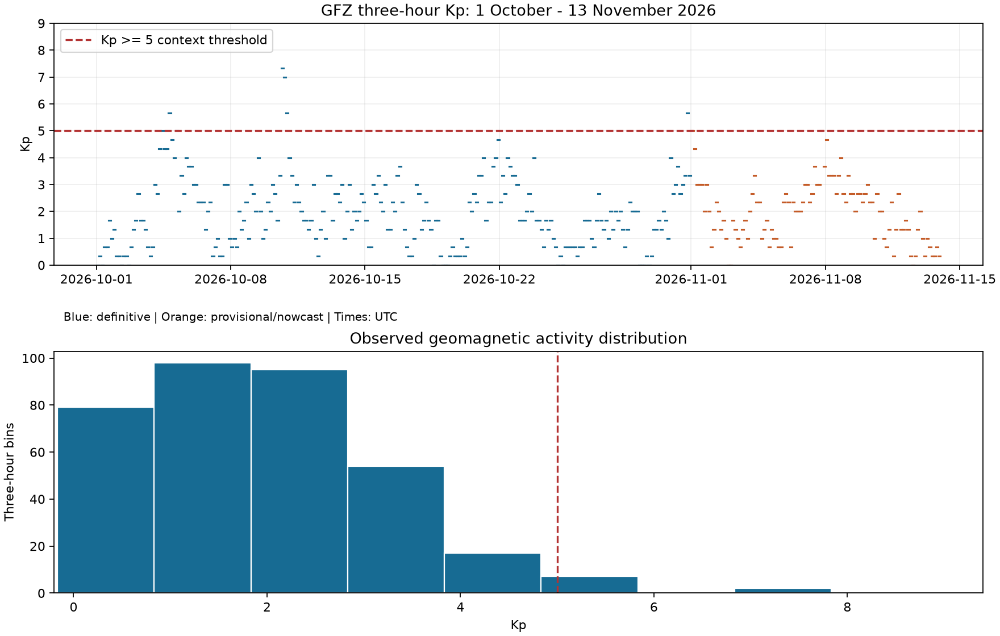

# Satellite Degradation Study

Investigating whether public orbital histories can provide early warning of satellite degradation in LEO megaconstellations.

**Author:** Varshita K (CS24BT007), Space and Data Science Club.

**Status:** Initial data-processing and exploratory-analysis milestone. A degradation detector has not yet been validated.

## Project documents
- [Problem statement](problem_statement.md) (PS document): motivation, research question and scope.
- [Pipeline](pipeline.md): inputs, scripts, processing steps and limitations.
- [Monthly progress](Report_month.md): completed work and next steps.
- [Detailed documentation](documentations.md): methods, provenance and work log.
- [Original proposal](Satellite_Degradation_Project_Proposal.pdf).

## Implemented so far
- Orbital-data validation, duplicate resolution, approximate feature calculation and coverage summaries.
- GFZ Kp analysis and alignment of historical orbital epochs with available space-weather observations.
- Catalogue matching, exploratory plots and reproducibility records.
- Seven automated tests covering core validation and calculations.



## Setup
Use Python 3.10 or newer. From the project folder on Windows:
```powershell
py -m venv .venv
.\.venv\Scripts\python -m pip install -r requirements.txt
.\.venv\Scripts\python -m unittest discover -s tests -v
```

## Run the analyses
Acquire the local inputs listed in [pipeline.md](pipeline.md), then run:
```powershell
.\.venv\Scripts\python src/analyze_kp.py
.\.venv\Scripts\python src/analyze_history.py
```
A fresh clone contains code and selected outputs, but no raw datasets. Tests run without the datasets. The current scripts use fixed input filenames and an October-November 2026 analysis window, documented in pipeline.md.

Optional current-snapshot acquisition:
```powershell
.\.venv\Scripts\python src/pipeline.py --fetch
```
This requires internet access and may fail if providers are unavailable. It does not replace historical orbital data. Historical analysis runs offline after manual downloads; never commit account credentials.

## Repository structure
```text
src/                    Acquisition and analysis scripts
 tests/                 Automated checks using synthetic fixtures
 data/raw/              Local original downloads (ignored by Git)
 results/space_weather/ Published initial GFZ analysis
 results/orbital_local/ Local detailed orbital analysis (ignored by Git)
```

## Limits and next steps
The initial historical sample is a convenience cohort from one launch. Orbital features are approximate mean-element proxies, not precise propagated positions. No orbital change is labelled as a failure, and weather overlap does not establish causation. Next steps are independently corroborated labels, manoeuvre investigation, SGP4 propagation, density modelling and temporal evaluation.

## Sources and data access
See [pipeline.md](pipeline.md) for official source links and exact input requirements. Raw downloads and detailed Space-Track-derived outputs remain local pending source-sharing review. GFZ and GCAT attribution is recorded in the documentation and provenance files.

Project repository: https://github.com/varshitakaipa/sds_project
