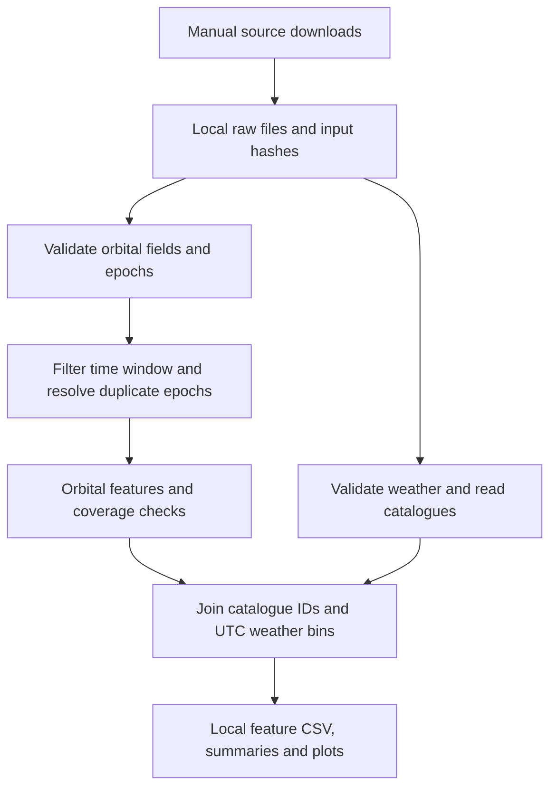

# Data and analysis pipeline

## Implemented workflow


## Entry points
| Script | Purpose | Outputs |
|---|---|---|
| `src/pipeline.py` | Fetch cached current Starlink/OneWeb GP snapshots and Kp; extract approximate orbital features | `results/summary.json`, optional feature CSV and altitude histogram |
| `src/analyze_kp.py` | Validate and analyse the saved GFZ Kp JSON offline | `results/space_weather/` |
| `src/analyze_history.py` | Process saved GP histories, catalogue matches, coverage and weather joins offline | `results/orbital_local/` (ignored by Git) |

## Required local inputs
Place these in `data/raw/` using the current script filenames:
- `starlink_history.json`: Space-Track GP_HISTORY JSON.
- `gcat_satcat.tsv` and `gcat_satcat100k.tsv`: standard and extended GCAT catalogues.
- `kp_2026-11-14.json`: GFZ three-hour Kp JSON with datetime and status arrays.
- `gfz_indices_20261001_20261113.txt`: 28-column GFZ combined solar/geomagnetic indices.
- `omni_dst_20261001_20261029.txt`: six-column NASA OMNI export (year, day of year, hour, magnetic field, proton density, Dst).
- Retain the accompanying OMNI format file to document column meanings.

The historical script currently uses the fixed UTC interval [2026-10-01, 2026-11-14). Adapt its configuration and input filenames deliberately for a new interval. A fresh clone does not contain raw inputs and cannot run the data analyses until these are supplied. Automated tests use synthetic fixtures and need no downloads.

## Validation and transformations
- Require valid finite orbital elements, UTC time system and SGP4 mean-element theory.
- Keep the latest CREATION_DATE for repeated satellite-ID/epoch pairs.
- Derive period, semi-major axis and approximate altitude/perigee/apogee using two-body formulas; these are exploratory mean-element proxies.
- Sort each satellite history, summarise gaps and calculate finite-difference altitude rates only for positive intervals of at most 48 hours.
- Join catalogue records by NORAD ID; preserve status as an uninterpreted field.
- Validate Kp array lengths, values, statuses and unique three-hour UTC timestamps.
- Join Kp/ap by containing three-hour UTC bin, solar indices by UTC date and Dst by containing UTC hour. Dst fill value 99999 and missing coverage remain missing.
- Record original-file SHA256 hashes and analysis timestamps; unknown manual retrieval times remain unknown.

## Run and verify
```powershell
python src/analyze_kp.py
python src/analyze_history.py
python -m unittest discover -s tests -v
```
Run these after installing dependencies as described in README.md. Only `python src/pipeline.py --fetch` requests network data; it is optional and is not needed for the offline historical workflow.

## Interpretation and remaining work
The weather joins describe retrospective context. Predictive features will need availability-aware lags to prevent leakage. Large orbital changes may reflect manoeuvres, deployment or element-fit noise; they are not failure detections. Plotted overlap with weather does not establish causation. Next work includes independently corroborated labels, broader cohorts, SGP4 propagation, manoeuvre analysis, density modelling and temporal evaluation.

## Data sources and sharing
- [Space-Track documentation](https://www.space-track.org/documentation)
- [GCAT, Jonathan McDowell](https://planet4589.org/space/gcat/)
- [GFZ indices](https://kp.gfz.de/en/data)
- [NASA OMNIWeb](https://omniweb.gsfc.nasa.gov/form/dx1.html)
- [CelesTrak GP formats](https://celestrak.org/NORAD/documentation/gp-data-formats.php)

Raw downloads and detailed Space-Track-derived outputs remain local and excluded from Git pending source-sharing review. Public repository contents include software, documentation, progress summaries and the initial GFZ weather analysis. Preserve source attribution and review provider terms before redistributing additional data or results.

## Milestone 2: daily robust screening
1. Read the cleaned `results/orbital_local/orbit_weather_features.csv` from the historical pipeline.
2. Aggregate satellite/UTC-day observations by median altitude proxy. Calculate changes only between adjacent observed dates; missing days are not bridged. Daily medians can mix different observation times and are not daily propagated positions.
3. Subtract the same-day leave-one-out median peer change when at least five peers exist. Peer objects belong to the same convenience cohort; they are not verified healthy.
4. Use dates strictly before the split (default `2026-10-22`) to fit each satellite's own change and peer residual reference. Require ten calibration points per feature. Freeze these references for later dates.
5. Compute score `(value - median) / max(MAD / 0.6745, 0.02 km/day)`. Flag a candidate only when both absolute scores exceed 3.5 and absolute peer residual is at least 0.1 km/day. These floor/gate values are unvalidated engineering choices.
6. Export scores, missing/ineligible days, candidate days, calibration settings, input hash and a threshold-sensitivity grid. Compare 3.5, 5 and 7 score thresholds and 0.05, 0.1 and 0.2 km/day change gates without choosing settings using health outcomes.

Run `python src/baseline.py --help` for input/output, split and scale-floor arguments. Run `python src/demo_baseline.py` for stable/shared-step/isolated-excursion/isolated-drift synthetic checks. These use no real orbital data and assert predetermined behaviour; they are not failure-prediction metrics.

Daily summaries and same-day peer information are retrospective. No element publication-time simulation is performed, so this is not an operational or availability-aware forecasting test. Counts measure review burden, not false alarms. Weather is retained as context, not corrected for. Real outputs remain ignored under results/orbital_local/.

Reference for median/MAD outlier scoring: [NIST](https://itl.nist.gov/div898/handbook/eda/section3/eda35h.htm). Its general 3.5 threshold is not a validated orbital-health boundary.
